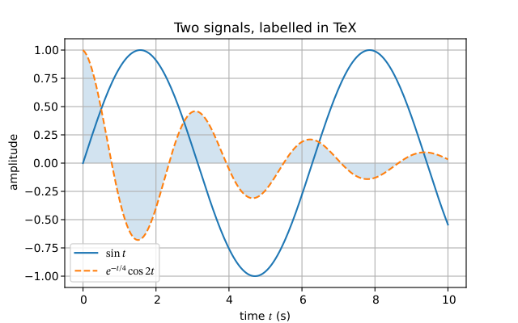

# go-plot/plot

[](https://github.com/go-plot/plot/actions/workflows/ci.yml)
[](https://pkg.go.dev/github.com/go-plot/plot)


[](./LICENSE)

Pure-Go (CGO=0) plotting for [go-ndarray](https://github.com/go-ndarray/ndarray):
matplotlib-class figures to SVG and PNG, with real TeX in the labels.



The object model and the defaults are matplotlib's — figure size, fonts, colour
cycle, margins, tick placement and tick labels — so a figure looks the way a
matplotlib user expects, and the parts that can be equal are **tested equal to
matplotlib**: tick locations and labels on 408 real axes, eight colormaps entry
for entry, and the layout of 30 figures (Axes positions, view limits, tick
labels, and positions after `TightLayout`). The API is the object-oriented one
that most notebooks use (`fig, ax = plt.subplots(); ax.plot(...)`). What Go adds: one static binary, `js/wasm`, no Python, and TeX labels
set by a real TeX math typesetter ([go-tex/math](https://github.com/go-tex/math)).

## Example

```go
package main

import (
	"math"
	"os"

	"github.com/go-plot/plot"
)

func main() {
	x := make([]float64, 200)
	y := make([]float64, 200)
	for i := range x {
		x[i] = float64(i) / 20
		y[i] = math.Sin(x[i])
	}
	fig, axs := plot.Subplots(1, 1)
	ax := axs[0][0]
	ax.Plot(x, y, plot.Label(`$\sin t$`))
	ax.Plot(x, y, plot.Marker("o"), plot.LineStyle("None"), plot.MarkerSize(2))
	ax.SetXLabel(`time $t$ (s)`)
	ax.Legend()
	fig.SavePNG(os.Stdout)
}
```

Data arguments take `[]float64`, other numeric slices, or a `*ndarray.Array` of
any dtype. A notebook kernel calls `fig.Display()`, which returns the figure as
`image/svg+xml` and `image/png`.

## What is in v0

| | |
|---|---|
| figures | `NewFigure`, `Subplots(rows, cols)`, `AddAxes`, size in inches and dpi, `TightLayout` |
| plots | `Plot` (lines, 17 markers, 4 line styles), `Scatter` (size and colour per point, colormaps), `Bar`, `Barh`, `Hist`, `FillBetween`, `ErrorBar`, `Imshow` (2-D data or RGB(A)), `Contour`, `Contourf`, `Axhline`, `Axvline`, `Text`, `Annotate` |
| axes | titles, labels, `Legend` (with `"best"`), `Grid`, `SetXLim`/`SetYLim`, linear and log scales, `TwinX`, manual ticks, aspect |
| colour | matplotlib's named colours, tab10 cycle, viridis, plasma, inferno, magma, cividis, gray, coolwarm, RdBu (and `_r`), `Colorbar`, `LogNorm` |
| output | `SaveSVG`, `SavePNG`, `Display` |

Not yet: symlog/date axes, `constrained_layout`, boxplot/pie/violin, hatching, windows
(go-widgets/window), PDF. The full list, and every place where go-plot differs
from matplotlib, is in [docs/design.md](docs/design.md).

## Compared with matplotlib

Rendering: twelve reference figures drawn by both (same data, size, dpi) put
every axes frame and every tick mark on the same pixel, and after
`TightLayout` within 2 pixels; the curves overlap to 0.970–1.000 (see [docs/design.md](docs/design.md#rendering-comparison), with the
negative controls the comparison is required to fail).

Speed, in-process, medians of 9 interleaved fresh-process runs on a loaded
16-core host ([docs/perf.md](docs/perf.md)):

| figure | go-plot | matplotlib 3.11.2 | |
|---|---|---|---|
| 1e6-point line → PNG | 0.055 s | 0.065 s | 1.2x |
| 1e6-point line → SVG | 0.019 s | 0.053 s | 2.8x |
| 1000² imshow → PNG | 0.025 s | 0.042 s | 1.7x |
| 1000² imshow → SVG | 0.020 s | 0.042 s | 2.1x |

Python's start and `import matplotlib.pyplot` (about 0.5 s) are not counted.

## Built on

[go-widgets/painter](https://github.com/go-widgets/painter) (compositing),
[go-gfx/gfx](https://github.com/go-gfx/gfx) (anti-aliased coverage),
[go-opentype](https://github.com/go-opentype) (DejaVu Sans, glyph outlines,
kerning), [go-tex/math](https://github.com/go-tex/math) (TeX),
[go-ndarray](https://github.com/go-ndarray/ndarray) (data).

## Development

```sh
go test ./...                                   # includes the matplotlib fixtures
uv run --with matplotlib --with numpy python tools/gen_ticks.py   # regenerate a fixture
cd tools/compare && go run . -out DIR && uv run --with matplotlib --with numpy python figures.py DIR \
  && uv run --with matplotlib --with numpy python compare.py DIR line=line ...
```

Write rendered images to a directory outside the repository.

## License

BSD 3-Clause. See [LICENSE](./LICENSE).
